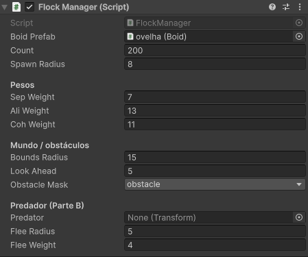
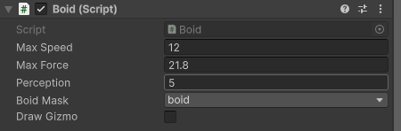

# FlockingBoid

## Integrantes 

Gabriel Torres.
Lucas Bragança.

## Instruções para abrir a cena principal

Abra o projeto e vá até a pasta Scenes e clique na SampleScene.

## Tabela com os parâmetros finais: pesos das três regras, raios, maxSpeed e maxForce

.
.

## Respostas e registros dos testes da Parte B.

### Teste 1 - Peso da separação = 0

É possível observar que quando o peso da separação se iguala a zero, o bando inicia bastante separado e vai se juntando aos poucos.

### Teste 2 - Peso do alinhamento = 0

Observa-se que o bando não se alinham o que faz com que eles se concentrem todos num mesmo centro de massa.

### Teste 3 - Raio de percepção 0,5 versus 5,0

Com o raio de percepção igual a 0,5 o bando se separa, não anda na mesma direção e alguns travaram nos obstáculos da cena. Por outro lado com a percepção igual a 5,0 o bando segue uma mesma direção, e voltam a ficar mais aglomerados que antes. OBS: Uns 3 ou 4 do bando travaram no obstáculo e se separaram do resto, talvez isso tenha ligação com o raio de percepção assim como talvez seja só por conta do travamento do obstáculo.

### Teste 4 - Predador
 
O bando faz o máximo possível para se manter longe do alcance do predador, mesmo com ele se arpoximando o bando prefere manter distância.